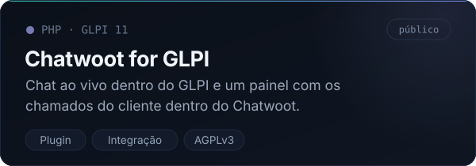
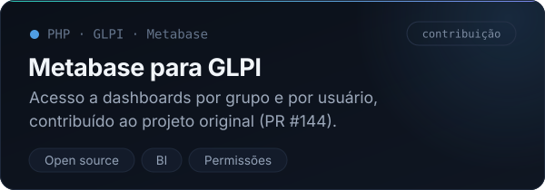
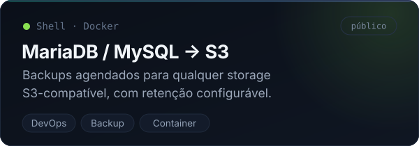
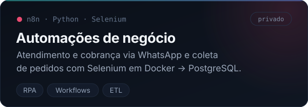

  

  
  
  <!-- Para adicionar o LinkedIn, troque SEU-USUARIO e descomente a linha abaixo -->
  <!--  -->

 

## Sobre

Cuido de infraestrutura, automação e desenvolvimento na **CAV SUL**, empresa do grupo Tupperware Latam. Sou o tipo de profissional que resolve de ponta a ponta: do servidor ao plugin, do workflow ao dashboard. Meu foco é fazer sistemas que não nasceram para conversar trabalharem juntos e transformar processos manuais em fluxos que rodam sozinhos.

#### Service desk · GLPI
- Plugins para GLPI 11: integração com Chatwoot, reserva de salas e **CSAT+**, que dispara pesquisas de satisfação no encerramento do chamado e tem dashboard próprio
- Contribuição ao plugin oficial do Metabase: acesso a dashboards por grupo e por usuário
- Tuning de performance em produção: PHP-FPM, OPcache, InnoDB, Redis e Nginx

#### Atendimento & IA
- Agentes de IA no n8n para atendimento e negociação via WhatsApp, com memória em Redis e integração ao Chatwoot
- Customizações no painel do Chatwoot: visibilidade por perfil, templates do WhatsApp preenchidos automaticamente e atalhos para os atendentes
- Leitura de NFS-e e boletos com IA para automatizar o contas a pagar

#### Automação & dados
- RPA com Selenium em Docker que extrai pedidos de um portal corporativo para o PostgreSQL, com análise de crédito e rastreio de entregas via API
- Onboarding automatizado de novos colaboradores
- Geração de Pix (BR Code) direto nos workflows

#### Infraestrutura
- Servidores Linux com Docker, Nginx, MariaDB, PostgreSQL, Redis e storage S3, monitorados com Grafana e Prometheus
- Storage corporativo de arquivos e MDM para a frota de smartphones da empresa
- Migrações de domínio AD e para o Microsoft 365, além de relay SMTP com Azure

 

## Stack

  

  

  
  
  
  
  

 

## Projetos em destaque

  
  
  
  

 

## Atividade

<picture>
  <source media="(prefers-color-scheme: dark)" srcset="https://raw.githubusercontent.com/MichaelRodriguesOficial/MichaelRodriguesOficial/output/github-snake-dark.svg">
  <source media="(prefers-color-scheme: light)" srcset="https://raw.githubusercontent.com/MichaelRodriguesOficial/MichaelRodriguesOficial/output/github-snake.svg">
  
</picture>

 

  Aberto a trocar ideias sobre infraestrutura, automação e open source.

